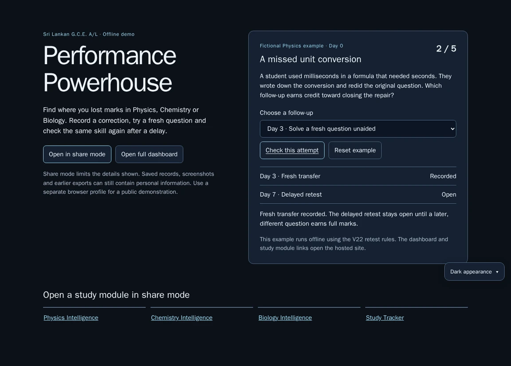

# Performance Powerhouse

A local-first study workbench for Sri Lankan G.C.E. A/L Physics, Chemistry and Biology. Record where a marked attempt went wrong, write a correction, then check the same skill on a fresh question and again after a delay.

**[Offline Physics demo](demo/repair-loop.html)** · **[Offline Biology Academy](demo/biology-academy.html)** · [Open the hosted workbench](https://al-performance-powerhouse.phenlleyniron.chatgpt.site/) · [Contribute](CONTRIBUTING.md)

Choose either offline file, select **Download raw file** on GitHub, and open the saved HTML in a browser. Physics walks you through a repaired mistake and two retests. Biology includes ten English-medium tracks with predictions, closed-book questions, written responses and marking points. Each file works on its own.



## Try V22 locally

From a clone of this repository, run this command with Python 3:

```sh
python3 scripts/preview-v22.py
```

Open **[Community Share on your computer](http://127.0.0.1:4173/community-share.html)**. Try the fictional Physics example. Repeating the same question leaves both checks open. A fresh, unaided solution on day 3 earns transfer credit. Another fresh solution on day 7 closes the delayed retest. Reset the example to try a different order.

**Open full dashboard** takes you to the actual V22 browser workbench. You can log your own attempt, link a retest, and export a backup. **Open in share mode** lets you preview the dashboard with personal details limited. The local preview serves static pages, including the proposed Community Share page. Cloud sync and sign-in require the hosted service.

## Which code should I use?

| Goal | Location |
| --- | --- |
| Read the V22 app, Worker, schema and tests | [working source](hosted-source/) · [original import](https://github.com/henlleyniron-byte/performance-powerhouse/tree/383c4f8dcb0cfe0adf6aad61be15596c7955c844/hosted-source) |
| Improve or review the local Community Share preview | [Community Share source](hosted-source/public/community-share.html) |
| Run the browser and data-integrity checks | [Contributor instructions](CONTRIBUTING.md#test-v22) |
| Verify the origin of the V22 files or see the list of omissions | [Source guide](docs/V22_SOURCE.md) · [per-file manifest](docs/V22_SOURCE_MANIFEST.json) |
| Work on the legacy V5.0.1 static app | [Root application](index.html) |

The working tree also includes [Biology Academy](docs/BIOLOGY-ACADEMY.md). The V22 archive comes from saved Site version 49, source commit `29314a708c0ab325ad1d9936ad17de747237c222`. The deployment succeeded on 29 October 2026 and the source was verified on 2 November. The public copy redacts private links and omits five downloads and two generated bytecode files. [V22 release notes](hosted-source/docs/RELEASE-V22.md) · [Earlier V16 archive](https://github.com/henlleyniron-byte/performance-powerhouse/tree/archive/site-history-review-20261021/hosted-source) · [Separate V5.3 engineering line](https://github.com/HenlleyNiron/performance-powerhouse)

## Legacy V5.0.1 application

### Why this project exists

Students often accumulate resources, trackers, notes, and revision plans without proving that a weakness has actually been corrected. Performance Powerhouse is designed around the opposite principle: capture the smallest useful evidence, identify repeated mark loss, repair the narrow cause, and require a later retest before calling the error stable.

### Core features

- Paper / attempt logging with score, time, confidence, guess and error evidence
- Repair prioritisation based on repeated mark loss and unresolved retests
- Explicit closed-book reattempt, transfer-question and delayed-retest stages
- Biology, Chemistry and Physics diagnosis guidance
- Local-first storage in the browser; no backend is required
- Share-safe display mode for demonstrations and screenshots
- JSON backup / restore and migration support from earlier builds
- Installable PWA shell for offline use
- Integrated Physics Intelligence module with aggregate 2000–2025 paper-pattern metadata
- Lightweight study-session tracker

### Run legacy V5.0.1

No build process is required.

1. Clone or download this repository.
2. Open `index.html` in a modern browser, or serve the folder with a static web server.
3. Complete the first-run profile.
4. Log a marked attempt and follow the repair loop.

For a local server, one simple option is:

```bash
python -m http.server 8080
```

Then open `http://localhost:8080`.

### Legacy entry points

- `index.html` — main Performance Powerhouse application
- `community-share.html` — public/share-oriented entry point
- `physics-intelligence/` — aggregate Physics paper-pattern explorer
- `study-tracker/` — local-first study-session evidence tracker

### Legacy privacy model

Performance Powerhouse is intentionally **local-first**. Study records are stored in browser `localStorage` rather than a central server. The repository contains application code and static aggregate datasets, not the maintainer's personal study history.

Share-safe mode is provided to reduce accidental exposure when demonstrating the application. Users should still review screenshots before publishing them.

### Physics Intelligence data

The included Physics Intelligence dataset stores aggregate counts, syllabus/taxonomy labels, years, question references, recurrence metadata, and derived statistics. It does **not** reproduce full exam-question text or answer keys.

See [`docs/DATA_PROVENANCE.md`](docs/DATA_PROVENANCE.md) for the data boundary and limitations.

## Project history

Performance Powerhouse existed and was iterated outside GitHub before this public repository was created. Earlier releases and QA packages were maintained through web deployments and private working archives. The Git history therefore begins with a migration of an already-existing project rather than pretending that the project originated on GitHub.

See [`docs/PROJECT_HISTORY.md`](docs/PROJECT_HISTORY.md).

## AI-assisted development disclosure

The project is maintained by **Henlley Niron Pushparajah** using an AI-assisted development workflow. AI tools are used for implementation, debugging, testing and documentation; project direction, acceptance/rejection of changes, release decisions, maintenance and responsibility for the published result remain with the maintainer.

## Contributing

Bug reports, accessibility improvements, documentation fixes and narrowly scoped study-workflow improvements are welcome. Please read [`CONTRIBUTING.md`](CONTRIBUTING.md) before opening a pull request.

## Security

Do not put personal study records, API keys, passwords, private documents or other secrets in issues or commits. See [`SECURITY.md`](SECURITY.md).

## License

Released under the [MIT License](LICENSE).
