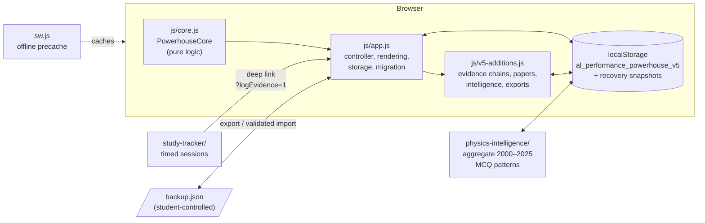
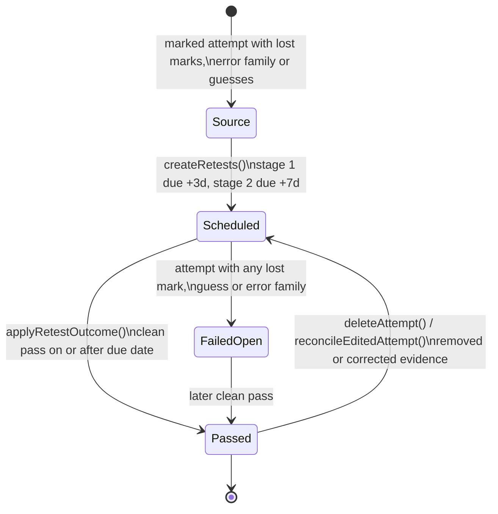

# Architecture

Performance Powerhouse is a static, offline-capable web application. It has no server, no
account system and no build step. This document explains how the pieces fit and why.

## Design constraints

| Constraint | Consequence |
| --- | --- |
| Students study on shared or low-end phones with unreliable data | Plain HTML/CSS/JS, no framework, works from any static host or `file://`, installable PWA with an offline shell |
| Study records are personal | Data stays in `localStorage`; nothing is transmitted; backups are explicit JSON files the student controls |
| The project has had many releases outside Git | Every storage key from V2 onward is still read and migrated forward; nothing is overwritten |
| A tracker can become procrastination | The app ranks *what to repair next* from evidence and blocks planning until a marked attempt exists (Execution Lock) |

## Runtime structure

- **`js/core.js`** is the only place business rules live in isolation: retest scheduling and
  closure, sanitisation of every stored or imported record, import inspection, and the demo
  dataset. It is DOM-free and loaded both by the browser and by `node:test` (through `vm`), so the
  rules the student relies on are unit-tested directly.
- **`js/app.js`** owns the UI: it renders panels, handles dialogs, persists state and runs the
  V2→V5 migration chain. It delegates every rule decision to `PowerhouseCore`.
- **`js/v5-additions.js`** layers the V5 views on top by wrapping `refreshAll` and adding panels.
  It shares top-level bindings with `app.js` (both are classic scripts), which is why the two are
  linted together.
- **Companion modules** keep separate storage keys so a bug in one cannot corrupt the main record.

## The evidence loop as data

A *clean pass* means full raw marks, full trusted marks, zero guessed items and no error family
(`isFullPass`). One verification attempt can close at most one scheduled check, and only the one
the student launched it from when that is known. Because outcomes are re-derived from the attempts
that still exist (`recomputeRetest`), deleting or correcting evidence can never leave a check
falsely closed.

## Trust boundary

Everything that crosses into the app from outside its own code is treated as untrusted:

1. **Stored state** (possibly written by an older build) → `normalizeState` on every load.
2. **Imported files** → `inspectImport` validates and summarises; the student confirms; a recovery
   snapshot is taken; only then is the sanitised state written.
3. **Rendering** → identifiers, enums, dates and numbers are constrained by the sanitiser; free
   text is passed through `escapeHTML` before reaching `innerHTML`.
4. **Content-Security-Policy** on every page: `script-src 'self'`, no inline scripts or handlers,
   no third-party origins. Even if a string slipped through, injected script would not execute.

## Storage keys

| Key | Owner | Notes |
| --- | --- | --- |
| `al_performance_powerhouse_v5` | main app | current schema 12 |
| `al_performance_powerhouse_v5_recovery` | main app | up to 12 snapshots taken before migration, import, export and reset |
| `al_performance_powerhouse_v4`, `_v3` | legacy | read once to migrate; never modified |
| `al_performance_command_centre_v3`–`v6`, `al_v2_samra` | legacy | read-only migration sources |
| `al_performance_powerhouse_study_tracker_v1` | Study Tracker | linked to attempts by `sessionId` |
| `al_performance_powerhouse_physics_intelligence_v1` | Physics Intelligence | personal overlay on the aggregate dataset |
| `al_performance_donated_tracker_archive_v1` | main app | unmapped legacy tracker imports kept for review |

Demo mode (`?demo=1`) builds a fictional record in memory and writes none of these keys.

## Testing strategy

| Layer | Tool | What it proves |
| --- | --- | --- |
| Core rules | `node:test` (`tests/unit/core.test.mjs`) | retest lifecycle, sanitisation, migration defaults, import inspection, demo validity |
| Static integrity | `node:test` (`tests/unit/integrity.test.mjs`) | unique ids, every `$('id')` lookup exists, local links resolve, CSP present, precache assets exist, versions agree |
| Service worker | `node:test` (`tests/unit/sw-contract.test.mjs`) | cache isolation and lifecycle contract |
| Browser | Playwright (`tests/e2e/`) | onboarding, navigation, attempt → retest flow, migration, backup round-trip, hostile-import safety, demo mode, mobile overflow |

CI runs all of them on every push and pull request, plus CodeQL and an optional Codex review.
